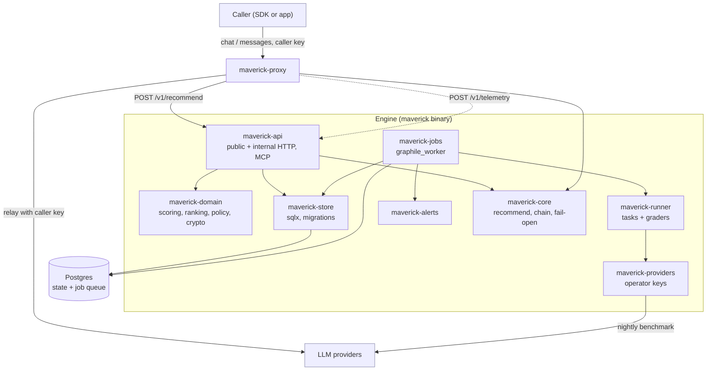

# Model Maverick

Model Maverick is a B2B recommendation engine for LLMs. It benchmarks models every night against a private task corpus, classifies each workload, applies tenant policy, and returns a ranked list of models (a fallback chain). The engine does not execute inference. The only component that executes inference is the proxy, and it uses only the caller's credentials.

[](https://github.com/donnfelker/model-maverick/actions/workflows/ci.yml)

This repository holds the Rust port of the engine, the proxy, and the SDK conformance harness. Other components live elsewhere: the Rails shell and the customer SDKs (TypeScript, Ruby, Go, Python).

## Key ideas and guarantees

The engine keeps a set of guarantees, G1 to G14, defined in [`specs/model-maverick-v1-spec.md`](specs/model-maverick-v1-spec.md). The main ones in plain language:

- **Privacy.** A prompt is never stored except in an encrypted debug-capture window. A prompt, a completion, a request body, or a credential never reaches a span, a log line, or a metric label. Every `#[tracing::instrument]` uses `skip_all` with an allowlist, and the `instrument-lint` CI check rejects any that does not.
- **Zero retention.** For a zero-retention tenant, the engine never sends a prompt or a pick to a column or an alias without valid zero-retention evidence. This rule fails closed and outranks the others.
- **Fail-open (G14).** An MM outage never breaks the customer's call. The SDK core falls open to the last-known-good chain, then a default model, then the caller's own model. The proxy is exempt today: an engine failure is its `502 engine_error`. `plans/production-proxy-plan.md` §4 (proposed D46) gives the proxy the same ladder.
- **Spend is capped (G8).** A batch projects its cost first and refuses to run when the projection is over the cap.
- **Pools are hard boundaries (G2).** A request can make a pool smaller. It can never make a pool larger.
- **No schema translation.** The engine and the proxy do not translate between provider wire formats.
- **Outcomes come only from MM components.** There is no `POST /v1/outcomes`. Outcome data arrives through `/v1/telemetry` from the proxy and the SDKs.
- **Postgres holds all state**, including the job queue. There is no Redis.
- **No MM-owned provider keys for customer traffic.** Operator keys are only for benchmarks and classification.

The private corpus (task prompts, golden answers, rubrics) is never committed to this repository.

## Architecture



A customer request enters the proxy. The proxy asks the engine for a recommendation, then relays the request to the first runnable provider using only the caller's credentials, and reports the outcome through `/v1/telemetry`. Every night the job runner benchmarks each model in the corpus with operator keys, scores the results, and updates the rankings the engine serves. See [`docs/architecture/`](docs/architecture/) for the detail.

## Repository layout

Crates live in `crates/`.

| Crate | Purpose |
|---|---|
| `maverick` | The engine binary and CLI. Wires the crates and runs `serve`, `migrate`, `corpus`, `mcp-stdio`, `demo-run`. |
| `maverick-api` | The public and internal HTTP listeners (axum), every endpoint, and MCP (rmcp). It calls services; it has no business logic. |
| `maverick-domain` | Pure domain logic: ids, task and grader types, scoring (EWMA/Welford), ranking, policy, ceilings, alias grammar, capture crypto. No I/O. `cargo-mutants` runs here. |
| `maverick-store` | The only crate with SQL. The sqlx pool, migrations, compile-time checked queries, and transactions. |
| `maverick-jobs` | The `graphile_worker` jobs: the batches lease, the spend guard, batches, the rebuild chain, alerts, and catalog jobs. Postgres is the only queue. |
| `maverick-runner` | The measurement runner: drives tasks through providers and graders. |
| `maverick-providers` | Hand-written typed provider clients (Anthropic, OpenAI, Google; xAI via the OpenAI client), the deterministic fake provider, and retry. reqwest on rustls. |
| `maverick-config` | Environment parsing and validation for the engine. Fails loud on missing or invalid config. |
| `maverick-alerts` | Alert rows and their delivery: the insert helper and the SMTP and HMAC webhook fan-out. |
| `maverick-core` | The Rust copy of the shared SDK core: recommend client, chain executor, fail-open ladder, telemetry batcher, alias grammar, workload projection. The proxy depends on it. |
| `maverick-proxy` | The proxy binary. No database, its own deployment. Executes a chain with the caller's credentials only. |
| `sdk-conformance` | The conformance harness: a mock engine and a mock provider, plus the frozen cross-language scenarios and test vectors. |
| `maverick-acceptance` | Cross-cutting acceptance suites: the real engine and proxy in one process, on Postgres, with recording provider fakes and a mock OTLP collector. |
| `maverick-e2e` | The full-stack end-to-end harness: the real binaries as separate processes, on Postgres, against a fake provider over HTTP. Test-only, localhost only. |
| `maverick-testdb` | Test-only Postgres helper: one testcontainers Postgres 16 per test binary and an isolated database per test. |
| `parity-support` | Test-only helpers for parity fixtures and the manifest coverage checker. |
| `test-support` | Test observability: per-test tracing capture with a secret-leak guard, step logging, and parity diff and replay reporters. |
| `instrument-lint` | A CI lint for the G5 redaction rule (D19): it rejects any `#[instrument]` without `skip_all`. |

Other top-level directories:

| Directory | Purpose |
|---|---|
| `specs/` | The normative contracts. `specs/model-maverick-v1-spec.md` is the engine contract. |
| `parity/` | The Go parity data: `manifest/` (the Go test list), `fixtures/`, and `DIVERGENCES.md` (the approved differences). |
| `reference/` | The exact Go behavior (strings, constants, order, quirks) for points the specs do not fix. |
| `plans/` | The design summary, decisions, and build order. |
| `docs/` | Product and operator documentation, plus `docs/architecture/`. |
| `scripts/` | `ci.sh` (the test tiers), `e2e.sh`, `latency.sh`, `docker-smoke.sh`, `backup.sh` and `restore-test.sh`, `sqlx-prepare.sh`, the demo, and the live smoke script. |

## Getting started

### Prerequisites

- The Rust toolchain pinned in [`rust-toolchain.toml`](rust-toolchain.toml) (current stable, 2024 edition, with `rustfmt` and `clippy`). `rustup` reads this file.
- Docker, for the testcontainers Postgres the store and job tests use.
- A Postgres instance for running the engine locally.
- The CI tools at the versions CI pins: `cargo-deny`, `cargo-mutants`, and `sqlx-cli`.

### Build

```bash
git clone https://github.com/donnfelker/model-maverick.git
cd model-maverick
cargo build --workspace
```

### Configure

The engine reads its configuration from the environment (`maverick-config`), and it fails loud on a missing or invalid value. The proxy reads its own set (`maverick-proxy/src/config.rs`). Those two files are the authoritative reference; `docs/architecture/` documents the full set. The essentials:

Engine:

| Variable | Purpose | Default |
|---|---|---|
| `MAVERICK_DATABASE_URL` | Postgres connection string. | required |
| `MAVERICK_PUBLIC_ADDR` | The public API listen address. | `:8080` |
| `MAVERICK_INTERNAL_ADDR` | The internal (operator) API listen address. | `:8081` |
| `MAVERICK_INTERNAL_TOKENS` | Bearer tokens for the internal API, as `name:secret` pairs. | required |
| `MAVERICK_CAPTURE_MASTER_KEY` | The key that encrypts the debug-capture window. | required for capture |
| `MAVERICK_{ANTHROPIC,OPENAI,GOOGLE,XAI}_API_KEY` | Operator provider keys for benchmarks and classification. | empty (provider default) |
| `MAVERICK_{ANTHROPIC,OPENAI,GOOGLE,XAI}_BASE_URL` | Override a provider base URL (tests point these at a fake). | empty (provider default) |
| `MAVERICK_OTEL_EXPORTER_ENDPOINT` | The OTLP endpoint; empty disables OTel. | empty |

Proxy:

| Variable | Purpose | Default |
|---|---|---|
| `MAVERICK_PROXY_MODE` | `self-hosted` or `hosted` (D13). | `self-hosted` |
| `MAVERICK_ENGINE_URL` | The engine base URL the proxy calls for recommendations. | `http://localhost:8080` |
| `MAVERICK_API_KEY` | The tenant key, in self-hosted mode. | required (self-hosted) |
| `MAVERICK_UPSTREAM_{OPENAI,ANTHROPIC,GOOGLE,XAI,OPENROUTER}` | Provider base URLs the proxy relays to. | the provider's public base |
| `MAVERICK_PROXY_ADDR` | The proxy listen address. | `:8090` |
| `MAVERICK_PROXY_TELEMETRY` | Set to `off` to send no telemetry. | on |

### Run

```bash
# Apply the database migrations.
MAVERICK_DATABASE_URL=postgres://localhost/maverick cargo run -p maverick -- migrate

# Start the engine (public 8080, internal 8081).
MAVERICK_DATABASE_URL=postgres://localhost/maverick \
MAVERICK_INTERNAL_TOKENS=rails:secret \
MAVERICK_CAPTURE_MASTER_KEY=$(head -c 32 /dev/urandom | xxd -p -c 64) \
cargo run -p maverick -- serve

# Start the proxy (self-hosted), pointing at the engine.
MAVERICK_PROXY_MODE=self-hosted \
MAVERICK_ENGINE_URL=http://localhost:8080 \
MAVERICK_API_KEY=mk_live_example \
cargo run -p maverick-proxy
```

A first request goes to the proxy, which routes a `maverick/*` alias through the engine and relays to the provider with your own key:

```bash
curl http://localhost:8090/v1/chat/completions \
  -H "Authorization: Bearer $OPENAI_API_KEY" \
  -H "Content-Type: application/json" \
  -H "X-Maverick-Workload: structured_extraction:3" \
  -d '{"model":"maverick/auto","messages":[{"role":"user","content":"Hello"}]}'
```

## Testing

All tests run through the tiers in [`scripts/ci.sh`](scripts/ci.sh):

| Tier | What it runs |
|---|---|
| `fast` | `cargo fmt --check`, `cargo clippy -- -D warnings`, `cargo test --workspace`, `cargo deny`, the sqlx offline check, the strict manifest audit (`parity_coverage --strict`), the `#[instrument]` lint (`scripts/check-instrumentation.sh`), and two grep checks with their own test (`scripts/tests/ci-checks.sh`): no match of the old try-it label, and no billing state in engine source or schema (`plans/production-proxy-plan.md` §8). The store and job tests on a real Postgres (testcontainers) run here, inside `cargo test --workspace`. |
| `db` | A placeholder. It has no separate suite, because the store and job tests already run in `fast`. |
| `parity` | The proxy replay, the API replay, and the SDK conformance scenarios (proxy and core-direct), each checked against the reviewed `DIVERGENCES.md` allowlist. |
| `e2e` | The full-stack script (`scripts/e2e.sh`): the real binaries on Postgres against the fake provider. |
| `mutants` / `mutants-diff` | `cargo-mutants` on `maverick-domain` (a full run or one shard, or only the changed lines). CI runs the changed lines on each push and the full run in eight nightly shards. |

```bash
scripts/ci.sh            # every tier except mutants
scripts/ci.sh fast
scripts/ci.sh parity
```

CI runs with `SQLX_OFFLINE=true` and the query cache that `scripts/sqlx-prepare.sh` writes, so it needs no database to compile. CI never calls a real provider. Every test uses the deterministic fake provider. The one live smoke test is opt-in and has a spend cap.

Outside the tiers, `scripts/latency.sh` measures the hot-path latency targets and `scripts/docker-smoke.sh` checks the deploy images. See [`docs/architecture/testing-and-parity.md`](docs/architecture/testing-and-parity.md) for every suite and harness.

## Contributing

- Read [`AGENTS.md`](AGENTS.md) first. It states the language and stack, the order of authority, the parity rules, and the guarantees you must not break.
- Task tracking uses Beads (`br` / `bd`) with the `bv` triage sidecar. Issues live in `.beads/`.
- Work directly on `main`. Use plain `git`, stage files by name, and never use `git add -A` or `--no-verify`. Make one commit per unit of work.

## Documentation

- [`docs/architecture/`](docs/architecture/) explains each area with diagrams.
- [`docs/api.md`](docs/api.md) is the HTTP and MCP API reference.
- [`docs/onboarding.md`](docs/onboarding.md) is the new-contributor guide.
- [`docs/operations.md`](docs/operations.md) is the operator runbook.
- [`specs/model-maverick-v1-spec.md`](specs/model-maverick-v1-spec.md) is the engine contract.

## License

Model Maverick is released under the [MIT License](LICENSE).
