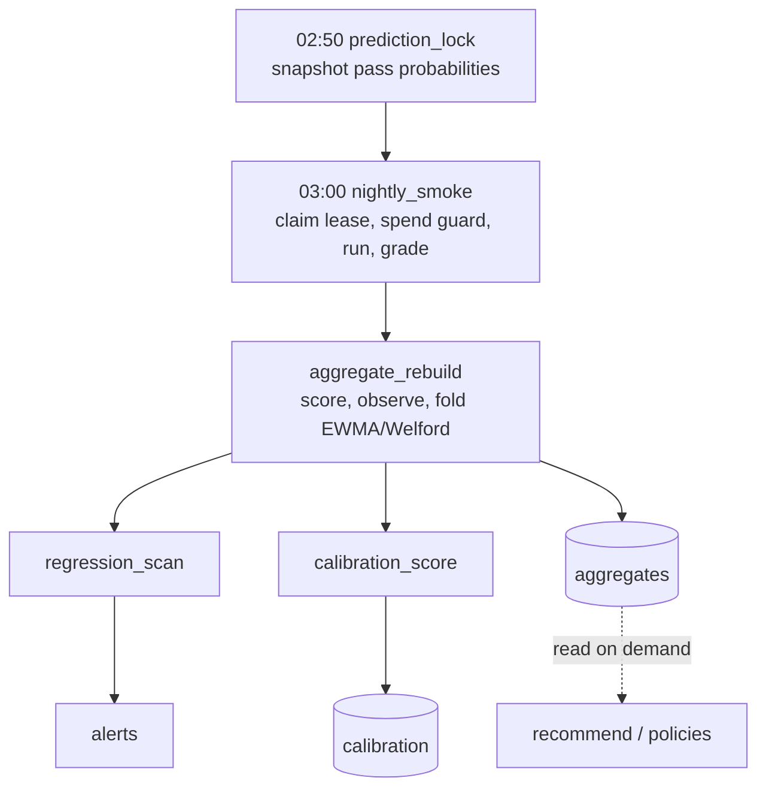

# Nightly benchmark

Every night the engine benchmarks the models against the active corpus, scores the results, and refreshes the aggregates that the next day's recommendations are computed from. The whole chain runs as `graphile_worker` jobs (see [Jobs and scheduling](jobs-and-scheduling.md)) under a batch lease, so it survives a worker crash and resumes where it left off.

## The chain

## The steps

1. **02:50, `prediction_lock`.** For each scheduled cell, the job snapshots the pass probability implied by its pass-rate EWMA into `predictions`. The first lock for the night wins. This is the "before" picture that `calibration_score` later checks.

2. **03:00, `nightly_smoke`.** The job claims the `batches` lease for the night's window, composes the task groups, and projects the run's cost. The **spend guard (G8)** runs first: over the cap, the batch refuses, writes a `skipped` status, and raises a critical `spend_refusal` alert; at eighty percent or more of the cap it raises a `spend_warning` and runs. The batch then drives the groups through the runner under a deterministic batch id, with resume and heartbeats, and grades the new runs into `scores` through the domain grader registry. In one transaction with the lease completion (D11) it writes any failure-tail alerts and enqueues `aggregate_rebuild`.

3. **`aggregate_rebuild`.** This is the choke point. It reads the batch's runs and scores, scores each run (the variance and ambiguity penalties, autofail), observes each cell (quality, ambiguity, pass rate, availability, latency p50 and p95, cost), and folds the observations into the append-only `aggregates` with an EWMA and Welford variance update. In one transaction it folds every cell, completes the lease, and chains `regression_scan` and `calibration_score`. A retry redoes the whole night.

4. **`regression_scan`.** It detects per-cell quality regressions, with dedup and a severity set by each tenant's quality bar, and runs the parse-failure watch. The alerts commit with the lease completion and notify after the commit.

5. **`calibration_score`.** It compares the night's locked predictions with the observed outcomes per capability and writes the Brier score and overconfidence to `calibration`.

## The runner

The runner (`maverick-runner`) drives a batch of task by column by repeat. Providers run concurrently, but each provider has a bounded worker pool with a rate-limit pacer, and all repeats of one pair run in order on one worker, because the repeats measure variance and not throughput. The default is three repeats, each wrapped in a per-run timeout (120 s by default). Each call produces one `runs` row with the output, tokens, latency, cost, and a status of `ok`, `provider_error`, or `timeout`. The runner never writes `parse_failure`; grading is a separate step in the batch job. Only runnable columns (cold start, active, deprecated) run, and a resumed batch skips runs already done.

## Rankings are not stored

The rankings and the banded policy table are not stored. They are recomputed on demand from the latest `aggregates` when `GET /v1/policies` or `POST /v1/recommend` is served (see [Request path](request-path.md)). The nightly chain's job is to keep those aggregates fresh and correct. This is why an `aggregate_rebuild` is the pivot of the night: once the cells are folded, the next day's recommendations already reflect them.

## Determinism and cost control

The benchmark uses operator keys, never MM-owned keys for customer traffic, and it never runs a real provider in CI (the tests use the deterministic fake provider). Live spend is bounded by the nightly and weekly caps (`MAVERICK_SPEND_NIGHTLY_CAP_USD`, `MAVERICK_SPEND_WEEKLY_CAP_USD`), enforced by the spend guard before any provider call.
