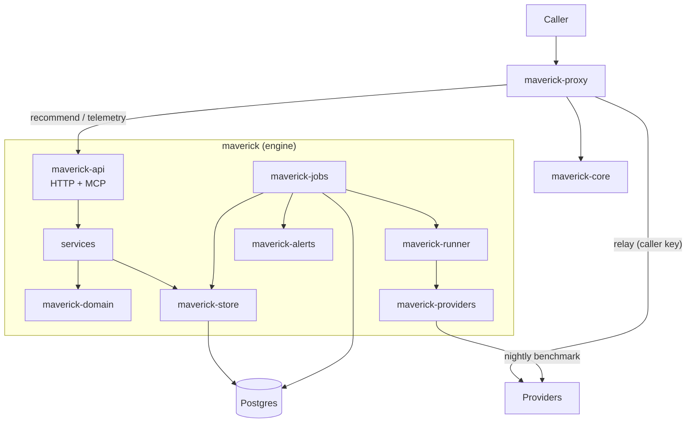

# Overview

Model Maverick has two runtime components and one shared library.

- **The engine** is the `maverick` binary. It serves recommendations and telemetry over HTTP, and it runs the nightly benchmark jobs. It owns the Postgres database.
- **The proxy** is the `maverick-proxy` binary. It is a separate deployment with no database. Customer traffic flows through it. It asks the engine for a chain, then relays the call to a provider with the caller's credentials.
- **`maverick-core`** is the shared library that both the proxy and the customer SDKs are built on: the recommend client, the chain executor, the fail-open ladder, the telemetry batcher, the alias grammar, and the workload projection. It keeps the proxy and the four SDKs behaving the same way.

## Component map

The engine crates form a layered stack. `maverick-api` holds the HTTP and MCP surface and no business logic: it calls services, which call `maverick-domain` (pure logic, no I/O) and `maverick-store` (the only crate with SQL). `maverick-jobs` runs the background work on `graphile_worker`, driving `maverick-runner` (tasks and graders) and `maverick-providers` (the typed clients). `maverick-config` parses the environment and fails loud. `maverick-alerts` delivers alerts by SMTP and signed webhook.

## The two flows

**A customer request** enters the proxy. The proxy parses the `maverick/*` alias, picks the workload (a declared header or a prompt projection), and calls the engine's `POST /v1/recommend`. The engine classifies the workload, applies the tenant's policy and pools, ranks the eligible models, and returns a fallback chain. The proxy walks the chain: for each entry it builds one upstream request with the caller's key and the entry's settings, sends it, and relays the first response that settles. It reports the outcome to `POST /v1/telemetry`. If the engine is unreachable, the SDK core fails open to the last-known-good chain, a default model, or the caller's own model. The proxy itself does not fail open: an engine failure is its `502`. See [Request path](request-path.md) and [Proxy](proxy.md).

**The nightly benchmark** is a cron job on the engine. It runs the active corpus through every model in the catalog with operator keys, grades the results, updates each model's score with an exponential moving average, scans for regressions, and rebuilds the rankings that the next day's recommendations use. It projects its spend first and refuses to run over the cap. See [Nightly benchmark](nightly-benchmark.md).

## Design rules that shape the code

- The engine and the proxy never translate between provider wire formats. The caller's body reaches the provider with the model swapped and the entry's settings applied, nothing more.
- Postgres holds all state, including the job queue. There is no Redis.
- No prompt, completion, request body, or credential reaches a log, a span, or a metric. See [Privacy and zero retention](privacy-and-zero-retention.md).
- Every behavior is checked against the recorded Go behavior in `parity/`. See [Testing and parity](testing-and-parity.md).
