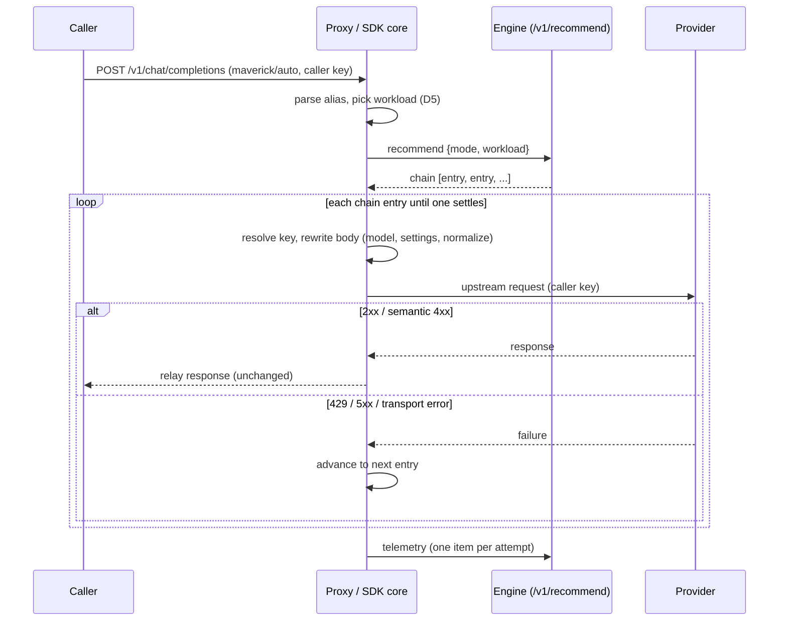

# Request path

This is the path a customer's chat request takes through the trial proxy and the engine. The pieces live in `maverick-core` (shared with the SDKs) and `maverick-proxy` (the HTTP shell). The [Trial proxy](trial-proxy.md) document covers the proxy's own pipeline steps (auth, body cap, rate limit); this document covers the recommend-and-relay core.

## The steps

## Alias and workload

The model field selects behavior through the alias grammar (`maverick-core::alias`). `maverick/auto`, `maverick/quality`, and `maverick/cost` map to the balanced, quality, and cost ranking modes. `maverick/<pool>:<mode>` selects a pool. A suffix `?settings=caller` (D14) tells the proxy to keep the caller's parameters instead of applying the entry's settings. A concrete model name (no `maverick/` prefix) is not routed: the proxy answers `400 invalid_model_alias`, and an SDK core passes it straight through to the provider.

The workload (D5) is either declared or projected. A present `X-Maverick-Workload` header (`capability:tier`) selects the declared form, and nothing about the prompt leaves the process. Without the header, the body is projected into a short classification text (`projection_version` `p1`). A zero-retention tenant never projects: it sends the declared fallback so the prompt stays local.

## Recommend

The proxy calls `POST /v1/recommend` with the tenant key, the mode, and the workload. The engine classifies the workload, applies the tenant's policy and pools (a pool can only shrink, never grow, G2), ranks the eligible models, and returns a recommendation: a `recommendation_id`, a `chain` of entries, and flags such as `zero_retention` and `telemetry` (the D39 opt-out). Each entry carries a provider, a model, an endpoint, the entry's settings, parameter constraints (D29), and any execution aliases (D15 OpenRouter).

## Chain execution

The chain executor (`maverick-core::chain`) walks the entries in order and decides from the response head alone, before any body byte is read:

| Outcome | Action |
|---|---|
| transport timeout | advance |
| any other transport error | advance |
| 429 | drain, obey `Retry-After` (D26), advance |
| 5xx | drain, advance |
| anything else (2xx, 3xx, or a non-429 4xx) | relay and stop |

For each entry a `prepare` step builds one upstream request: it resolves the key (the caller's native key, or an operator env key, or skip), builds the URL for the provider and surface, and rewrites the body (swap the model, apply the entry's settings unless the alias opted out, normalize the parameters per D29). The relayed response passes back to the caller unchanged. The proxy does not translate wire formats.

On exhaustion (every entry skipped or advanced) the proxy answers `502 no_executable_candidates`. An SDK core instead surfaces the last provider error unchanged.

## Fail-open

Fail-open (G14) is the SDK core's behavior when the engine itself is unreachable, in `maverick-core::failopen`. An MM outage never breaks the customer call. The ladder is:

1. The last-known-good chain for this workload, cached in memory (a zero-retention tenant keeps only its zero-stamped entries).
2. The configured default model.
3. The caller's own concrete model.

Privacy outranks G14. A terminal privacy error from the engine (`422 zero_retention_requires_declared`, `409 no_compliant_columns`) is surfaced unchanged, never failed open, and it purges the tenant's cached chains. A zero-retention tenant with no compliant fallback fails closed.

The trial proxy is exempt from fail-open by position: it maps an engine failure to `502 engine_error`. It still obeys the zero-retention rules.

## Where this is verified

The `sdk-conformance` crate replays the frozen cross-language scenarios against both the real proxy and the `maverick-core` pieces directly, and asserts the recorded engine, provider, and telemetry traffic. See [Testing and parity](testing-and-parity.md).
