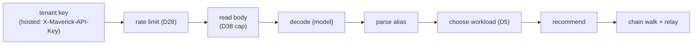

# Trial proxy

The trial proxy (`maverick-proxy`) is the only component that executes customer inference, and it uses only the caller's credentials. It is a separate deployment with no database. It is built on `maverick-core`, so it runs the same recommend, chain, and telemetry logic as the customer SDKs. See [Request path](request-path.md) for the recommend-and-relay core; this document covers the proxy's own configuration, pipeline, and credential rules.

## Deployment modes

The mode is fixed per deployment by `MAVERICK_PROXY_MODE`.

- **Self-hosted** (the default, the Go behavior): one configured `MAVERICK_API_KEY` is the tenant key for every recommend call, and the provider env keys are loaded as a credential fallback.
- **Hosted** (MM's shared instance, D13): the tenant key arrives per request in `X-Maverick-API-Key` and must start with `mk_live_`, so `MAVERICK_API_KEY` is not read. No provider env key is ever read, not even looked up (D12), so a hosted instance given only an OpenAI key never calls Anthropic.

## The pipeline

`Proxy::handle` runs these steps, and the first failing step decides the response:

- **Auth.** Hosted mode reads and validates the tenant key before the body is read, so an unauthenticated caller cannot make the proxy buffer a body.
- **Rate limit (D28).** Per tenant key, `MAVERICK_PROXY_RATELIMIT_RPM` requests per minute (default 60). Over the limit is `429 rate_limited`, and neither the engine nor a provider is called.
- **Body cap (D38).** Over `MAVERICK_PROXY_MAX_BODY_BYTES` (default 32 MiB), by the declared `Content-Length` or the bytes read, is `413 payload_too_large`.
- **Decode and alias.** A malformed body is `400 invalid_request`. A model that is not a `maverick/*` alias is `400 invalid_model_alias`.
- **Recommend.** A terminal privacy error is relayed as `422` or `409` with its code. In hosted mode an engine `401` becomes `401 unauthorized` and a `403` is relayed with its code (D13). Any other engine failure is `502 engine_error` and one ERROR log line. The proxy does not fail open (G14 is the SDK core's job by position).
- **Chain walk.** The chain executor relays the settled attempt, or answers `502 no_executable_candidates` on exhaustion.

## Credentials

The caller's provider credential arrives on the surface's native slot: `Authorization: Bearer` on the chat surface (native provider `openai`), `X-Api-Key` on the messages surface (native provider `anthropic`). For each chain entry, `resolve_key` picks the key: the caller's credential for the native provider, else the provider's env key (self-hosted only), else the entry is skipped. So a self-hosted proxy configured with several provider keys can run a cross-provider chain, and a hosted proxy is restricted to the credential's own provider.

Upstream headers start from the client's headers, drop the hop-by-hop set, `Host`, `Content-Length`, the credential headers, and (D30) `X-Maverick-API-Key`, then add the per-attempt credential. The tenant key never reaches a provider, and a caller key never reaches the engine.

## OpenRouter execution (D15)

A caller key that starts with `sk-or-` is an OpenRouter credential, recognized in hosted mode. Every chain entry then runs on the one OpenRouter upstream, using the entry's `execution_aliases.openrouter` slug as the model. An entry without that alias is skipped. For a zero-retention tenant each attempt forces OpenRouter's Zero Data Retention option, an alias that is not verified `zero` is skipped, and a chain with none left answers `409 no_compliant_columns` before any upstream request. There is never a direct-key fallback.

## Telemetry

After the relay ends, the proxy reports one item per dispatched attempt to the engine's `/v1/telemetry`, batched per tenant key. A tenant that opted out (D39) or a request that dispatched nothing sends nothing. Telemetry off means zero bytes. See [Telemetry and outcomes](telemetry-and-outcomes.md).

The proxy's OTel record follows the same opt-out: an opted-out tenant's request exports no `maverick.recommendation` log record and is not counted (D43). See [Observability](observability.md).

## Configuration

The proxy reads its configuration once at startup from `maverick-proxy/src/config.rs`. Key variables: `MAVERICK_PROXY_MODE`, `MAVERICK_ENGINE_URL`, `MAVERICK_API_KEY` (self-hosted), `MAVERICK_UPSTREAM_{OPENAI,ANTHROPIC,GOOGLE,XAI,OPENROUTER}`, `MAVERICK_PROXY_ADDR` (default `:8090`), `MAVERICK_PROXY_MAX_BODY_BYTES`, `MAVERICK_PROXY_RATELIMIT_RPM`, `MAVERICK_PROXY_TELEMETRY`, and `MAVERICK_PROXY_OTLP_ENDPOINT`.
